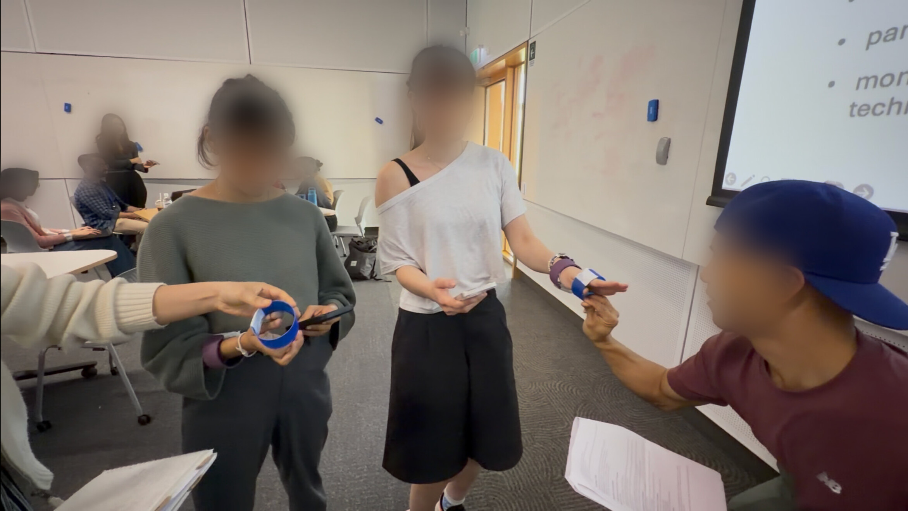
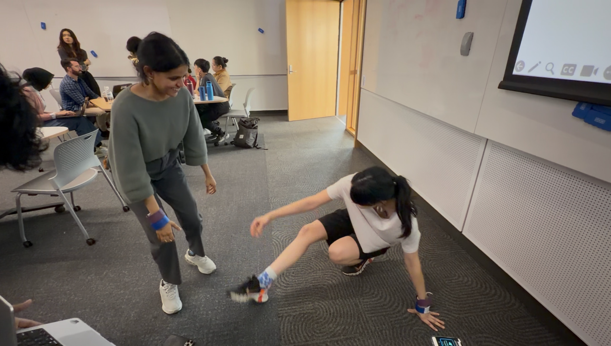
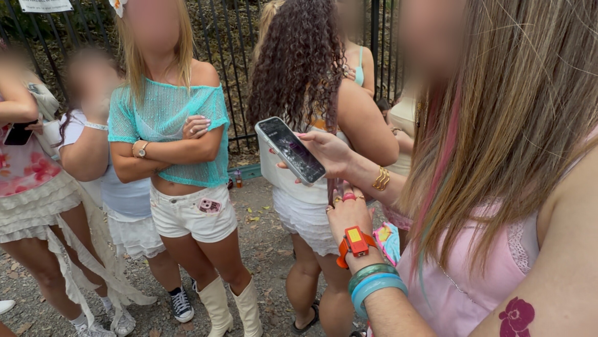
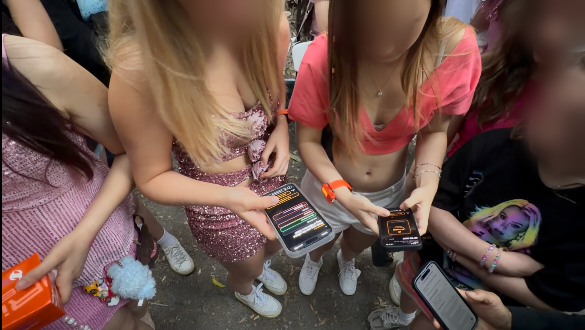
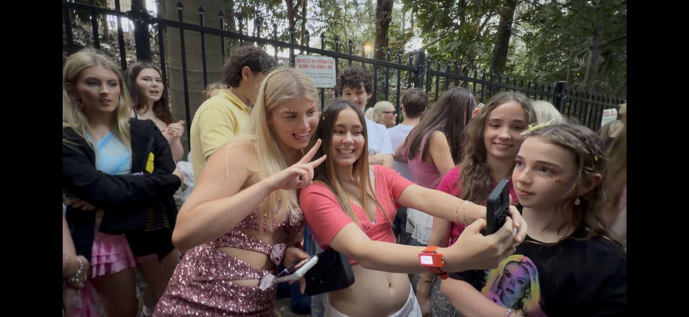

## Prototype Testing and Iteration

We conducted two rounds of prototype testing to understand how users experienced *On The Beat* and how we could improve the interaction. Our focus gradually shifted from encouraging people to dance together to creating a more comfortable and playful way to start conversations.

---

### Iteration 1 — Initial Prototype Testing

**What we tried**

Our initial prototype combined wearable devices with a dance challenge to encourage interaction between concertgoers. We tested how participants responded to the wearable and whether dancing could work as an icebreaker.

*Figure 1. Testing the initial wearable-based interaction.*

*Figure 2. Participants trying the dance challenge during the first prototype test.*

**Key Findings**

- **Sudden interaction:** Dancing immediately after meeting someone felt awkward. The participant preferred having a conversation first.
- **Unclear instructions:** It was not clear whether users should dance together, take turns or form a group.
- **Wearable concerns:** The device should signal openness to socialising rather than identify someone as attending alone.
- **Reward preferences:** Smaller souvenirs, such as stickers or temporary tattoos, were preferred over T-shirts.
- **Broader audience:** Willingness to socialise may matter more than whether someone attends a concert alone.

**What we learned**

The main issue was not necessarily meeting new people, but how the interaction begins. Participants needed a clearer and more gradual way to move from meeting someone to taking part in an activity.

---

### Refinement 1 — From Pressure to Playful Interaction

Based on the feedback, we explored a more gradual interaction flow:

**Match → Talk → Play**

Instead of asking users to dance immediately, we introduced conversation prompts and explored different music-related icebreakers.

**Ideas explored:**

- **Guess the Song:** Guess song titles from short music clips.
- **Lyrics Challenge:** Take turns continuing song lyrics.
- **Trending Video Challenge:** Recreate a short video trend together.
- **Selfie Pose Challenge:** Follow prompts and take photos together.

We also considered improving the dance challenge through simpler movements, optional difficulty levels, practice time and cooperative tasks.

The goal was to give users more choice and control over how they participated.

---

### Iteration 2 — Testing the Refined Prototype

**What we tried**

Following the first iteration, we developed a more structured experience using a mobile application and wearable devices.

We conducted a second round of testing with concertgoers in a live concert-related environment. Participants were invited to try the prototype in pairs and provide feedback afterwards.

The experience included three main stages:

1. **Say Hi:** Use wearable colour signals and conversation prompts to begin interacting.
2. **Music Activities:** Explore activities such as song guessing, dancing and artist trivia.
3. **Finish:** Complete the experience and share feedback.

*Figure 3. Participants using the mobile application and wearable devices during the second test.*

*Figure 4. Participants trying the refined interaction in a concert setting.*

*Figure 5. Participants engaging in a shared activity during testing.*

**Key Findings**

**What worked:**

- Participants described the experience as fun, interactive and spontaneous.
- The activities helped participants break the ice.
- The fabric-based wearable received positive feedback for comfort.

**What still needed improvement:**

- Some participants struggled with navigation and did not realise they could choose or skip activities.
- Certain activities felt more individual than collaborative.
- Dancing could still feel awkward for some participants.
- Participants suggested more interactive mini-games, such as Pac-Man or Tic-Tac-Toe.

---

### Refinement 2 — Improving the Experience

Based on the second test, we identified three areas for further improvement:

| Area | Proposed Improvement |
|---|---|
| **Onboarding** | Simplify setup and reduce unnecessary steps. |
| **Activity Choices** | Make choosing, skipping and switching activities clearer. |
| **Collaboration** | Introduce more cooperative mini-games and shared tasks. |

During our team discussion, we also considered simplifying the demonstration flow so participants could reach the core social activities more quickly.

---

### Key Learnings

Through both rounds of testing, we learned that playful activities can create opportunities for social interaction, but they need to be intuitive, flexible and comfortable for different users.

Our design evolved from asking people to dance immediately to supporting a more gradual process of meeting, talking and playing together.

The second test also highlighted an important distinction between **engagement and social connection**. Enjoying an activity does not necessarily mean that a meaningful connection has been formed.

Overall, *On The Beat* explores how mobile applications and wearable technologies can support face-to-face interaction without replacing it.

**Technology opens the door. People make the connection.**
